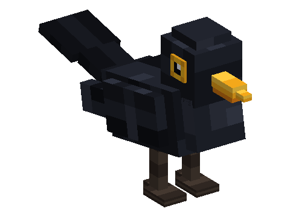

# Blackbirds

A mod of the [Sunrise Creatures](../../README.md) series, **planned**: a songbird of woods, meadows and gardens that
hops over the grass, perches in bushes and trees, sings at dawn and dusk, and pecks earthworms and berries.
**Requires** [Sunrise Creatures](https://playsunrise.net/mods/creature), the series' library.

Not playable yet: the first design and model are in [SPECS.md](SPECS.md).
