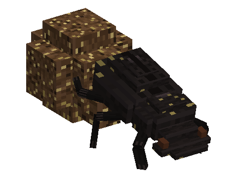

# Dung Beetles

A mod of the [Sunrise Creatures](../../README.md) series: small beetles that follow the grazing herds, roll balls of
dung in straight lines under the stars and bury them, turning worn ground back into grass. **Requires**
[Sunrise Creatures](https://playsunrise.net/mods/creature), the series' library.

## Finding them

They live in savannas, plains, sunflower plains, meadows and at the grassy edges of deserts, on grass, dirt or coarse
dirt, 1 to 3 together, by day and at night. They keep near the cows, sheep, horses, donkeys, mules, goats, camels and
llamas around them, and crawl about. Chickens peck them up: keep chickens out of the pasture.

In creative: the spawn egg (creative tab "Sunrise Creatures").

## Rolling the ball

Near a grazing animal, now and then (every couple of minutes), a beetle digs a ball where the animal stood, then rolls
it away backwards, pushing with its hind legs, for 8 to 16 blocks. On a clear night it is steered by the stars and its
line is perfectly straight; under clouds, rain or a roof it wanders. It climbs a one-block step and turns aside at a
fence or a wall. At the end it buries the ball in the ground below.

## Greener ground

A buried ball turns the block it is buried in greener: coarse or rooted dirt becomes dirt, dirt becomes grass, and on
grass short grass and a flower or two grow around, as bone meal does. Slow and quiet: the beetles mend what the herds
wear down.

Right-click a rolling beetle with an empty hand to take its **dung ball**: use it on dirt, coarse dirt, rooted dirt or
grass to do the same by hand, or put it in a composter, where it always adds a level.

## In a jar

Catch one with the series' glass jar and let it out among at least 3 grazing animals (within 8 blocks): it settles in
that pasture, follows the herd there, buries its balls there and never wanders off. With the herd gone, it is free
again.
