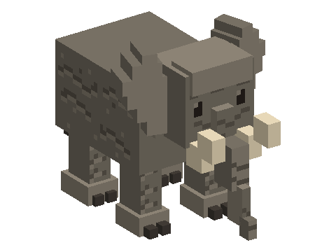

# Elephant

A mod of the [Sunrise Creatures](../../README.md) series, **in development**: a savanna elephant with individual stats and
distinct baby, juvenile and adult models. Breed and raise it; adults can carry two riders, a dyeable saddle blanket and
a double chest on each flank. It fears mice from a separate future mod, but does not require it. **Requires**
[Sunrise Creatures](https://playsunrise.net/mods/creature), the series' library.

Not playable yet: elephants roam the savannas, charge whoever hits them, can be tamed with thrown sugar cane, saddled,
dyed, ridden by two and loaded with two chests a flank, but can't be bred yet.
The design and what is done are in [SPECS.md](SPECS.md).
