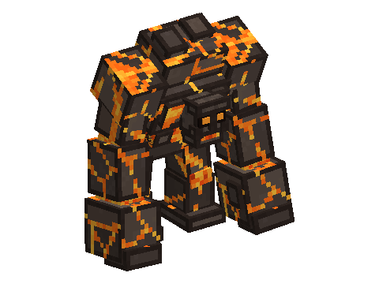

# Magma Golem

A mod of the [Sunrise Creatures](../../README.md) series: a giant of living magma, six blocks tall, asleep in the
Nether as a mound of glowing rock until you come too close. A rare mini-boss, found rather than summoned.
**Requires** [Sunrise Creatures](https://playsunrise.net/mods/creature), the series' library.

## Meeting one

Rarely, in the Nether's basalt deltas and wastes, near lava, a heap of dark rock glows softly: a magma golem asleep,
never within 256 blocks of another. Never on Peaceful. In creative: the spawn egg (creative tab "Sunrise Creatures").

Come within 6 blocks, hit it or mine next to it, and it rises with a roar. Then it fights under a boss bar, and comes
for you: it smashes its fist down when you are within reach, pounds the ground with both fists when you stand close
(a shockwave that throws you and sets fires around), leaps onto you from afar, and tears globs of magma from its
body to throw at you, which burst in flames where they land. Under half health it is enraged: faster, quicker to
strike, and its pounds shed small magma cubes. It is immune to fire and lava, and heals standing in them.

Its weakness is cold. Snowballs hurt it, and five in a row (or one splash water bottle) crust it over: its glow goes
dark, it slows down and takes double damage for a few seconds. Bring snow to the Nether.

Left alone for two minutes, it lies down again where it stands, its health restored.

## What it leaves

- **Its magma heart**, always. With a netherite pickaxe in a smithing table it makes a **molten pickaxe**, which mines
  as netherite and smelts what it mines: ores give ingots, sand gives glass, cobblestone gives stone, netherrack gives
  nether bricks, ancient debris gives netherite scrap, with a furnace's experience.
- Magma cream and magma blocks, and plenty of experience.

## Licence

Required Notice: Copyright (c) 2026 EAnathos (https://github.com/EAnathos/sunrise-creatures)

The code is under the [PolyForm Noncommercial License 1.0.0](https://polyformproject.org/licenses/noncommercial/1.0.0).
The artwork (models, textures, icons, pictures) is the author's, all rights reserved, under the terms of
[LICENSE-ART.md](https://github.com/EAnathos/sunrise-creatures/blob/main/LICENSE-ART.md). The sounds are CC0.
