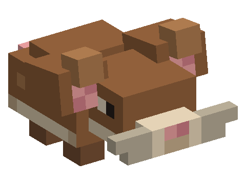

# Mice

A mod of the [Sunrise Creatures](../../README.md) series, **planned**: a small, peaceful field mouse with a warm brown
coat, large ears, whiskers and a long tail. Mice cannot be caught, tamed, fed or bred in v1; cats hunt them, and they
drop mouse meat. **Requires**
[Sunrise Creatures](https://playsunrise.net/mods/creature), the series' library.

Not playable yet: the first design and questions are in [SPECS.md](SPECS.md).
