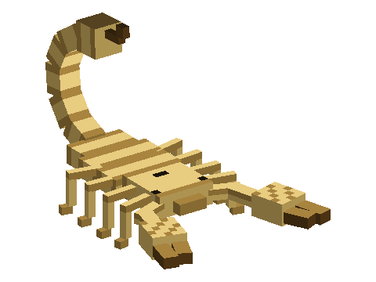

# Scorpions

A mod of the [Sunrise Creatures](../../README.md) series: scorpions of real size hiding in the shade
of deserts, badlands and caves, where some glow cyan in the dark. Come close and one rears up, claws open and tail
arched; hit it and it fights back with its claws and a poisoned sting. Its venom makes poison potions and arrows, its
stinger a dagger, and a glass jar makes it a terrarium pet. **Requires** [Sunrise Creatures](https://playsunrise.net/mods/creature), the series' library.

`/summon scorpions:scorpion ~ ~ ~ {Tags:["cave"]}` makes one of a kind (`desert`, `badlands` or `cave`). The design is
in [SPECS.md](SPECS.md).

## Licence

Required Notice: Copyright (c) 2026 EAnathos (https://github.com/EAnathos/sunrise-creatures)

The code is under the [PolyForm Noncommercial License 1.0.0](https://polyformproject.org/licenses/noncommercial/1.0.0).
The artwork (models, textures, icons, pictures) is the author's, all rights reserved, under the terms of
[LICENSE-ART.md](https://github.com/EAnathos/sunrise-creatures/blob/main/LICENSE-ART.md). The sounds are CC0.
