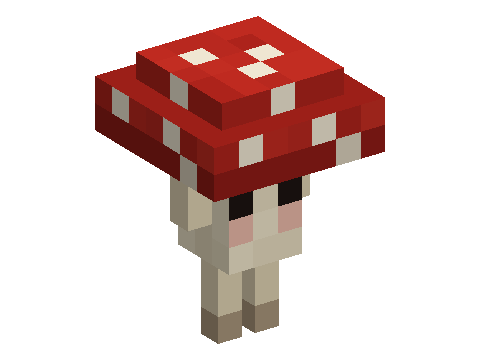
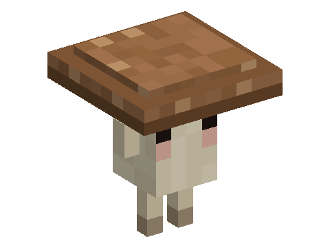

# Sporelins

 

A mod of the [Sunrise Creatures](../../README.md) series: small, shy mushroom sprites of dark forests and mushroom
fields. **Requires** [Sunrise Creatures](https://playsunrise.net/mods/creature), the series' library.

## Finding them

They live in dark forests, mushroom fields, old growth taigas and swamps, where it is dark, 1 to 3 together: red caps
(the more common in dark forests and mushroom fields) and brown caps. They waddle about and, now and then, plant a
mushroom of their cap's colour next to them.

Come near without sneaking and one **hides**: it sits down and pulls its cap over its stem, and passes for a mushroom
until you go away or stand still a few seconds. Hit one, or run at it, and it bursts a puff of spores (harmless) and
runs off. Killed, it drops a mushroom of its colour.

In creative: the spawn egg (creative tab "Sunrise Creatures").

## A friend

Right-click a sporelin with a mushroom of its colour: one chance in 3 it becomes your friend (hearts), otherwise it eats
it. Your sporelin follows you, waddling, and comes to you when you are far; right-click it to tell it to stay or follow.
Fed a mushroom of its colour, it heals.

- **A mushroom patch**: told to stay, it plants and tends mushrooms around where it stays (8 blocks), spreading them.
- **Mushroom stew**: give it an empty bowl and it hands back a mushroom stew, once a day; asked again the same day, it
  shakes its cap.
- **A night light**: at night the spots of its cap glow softly.

## Licence

Required Notice: Copyright (c) 2026 EAnathos (https://github.com/EAnathos/sunrise-creatures)

The code is under the [PolyForm Noncommercial License 1.0.0](https://polyformproject.org/licenses/noncommercial/1.0.0).
The artwork (models, textures, icons, pictures) is the author's, all rights reserved, under the terms of
[LICENSE-ART.md](https://github.com/EAnathos/sunrise-creatures/blob/main/LICENSE-ART.md). The sounds are CC0.
