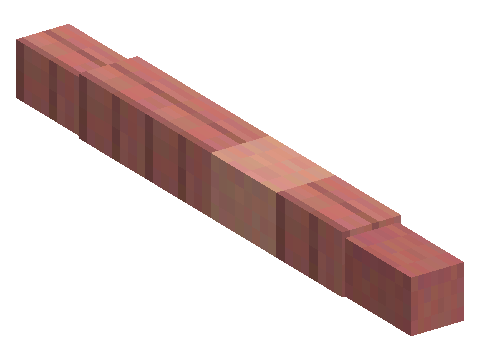

# Worms

A mod of the [Sunrise Creatures](../../README.md) series: earthworms you settle in your garden, where they help crops
grow. **Requires** [Sunrise Creatures](https://playsunrise.net/mods/creature), the series' library.

## Finding them

Worms crawl on the grass of plains, meadows, forests and taigas, and many more come up while it rains. In creative: the
spawn egg (creative tab "Sunrise Creatures").

## Gardens

Catch a worm with a **glass jar** (right-click it) and release it on farmland, or on a crop, in a garden of at least
10 connected farmland blocks. It stays there, and every 20 seconds it makes one of the garden's crops grow a stage
(green sparkles show which). Up to 3 worms help a garden. Keep chickens out of it: a chicken near goes for a worm and eats it.

## Licence

Required Notice: Copyright (c) 2026 EAnathos (https://github.com/EAnathos/sunrise-creatures)

The code is under the [PolyForm Noncommercial License 1.0.0](https://polyformproject.org/licenses/noncommercial/1.0.0).
The artwork (models, textures, icons, pictures) is the author's, all rights reserved, under the terms of
[LICENSE-ART.md](https://github.com/EAnathos/sunrise-creatures/blob/main/LICENSE-ART.md). The sounds are CC0.
